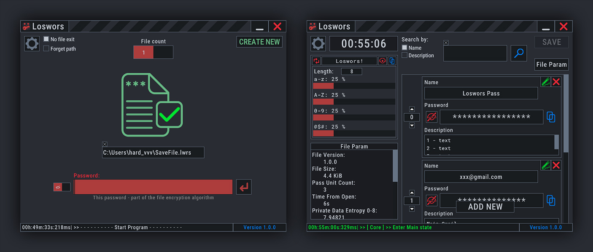
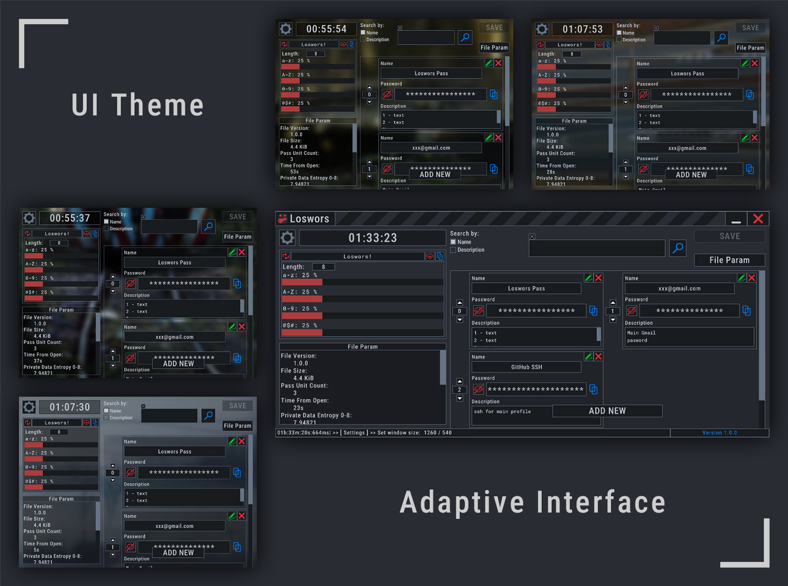

`Version 1.0.0`
- 1 `MAJOR` - for big changes
- 0 `MINOR` - breaking changes in file format or file loading logic (includes conversion)
- 0 `PATCH` - simple updates, bug fix

About version: `MINOR` - (file format) never resets to 0, `PATCH` - (update, bug fix) reset to 0 if `MAJOR` changes.

# Quick Introduction
Loswors is a local password storage app with open-source code, created by one person as a creative project.

The application has `NOT undergone independent security audits`, and its `cryptographic strength has NOT been verified`.
(Storing important information in this program's save files) / (Using the application to store important data) is `YOUR personal choice` and is done `at YOUR own risk`.

Author positions this application as an alternative to storing passwords in plain text files or other unencrypted forms.

# How It Works
Loswors is a local application that uses its own save file format and stores data offline on the device.

The main task is to protect data against offline cracking attempts in a situation where the encoding algorithm and the save file are known. The only thing that remains unknown is the password for the file (MASTER PASS).
MASTER PASS is the main secret known only to the user. After it is entered, a cascade of logical operations for decrypting the data takes place, and the data is displayed on the screen in its clear form.

The operating logic assumes that any MASTER PASS will always trigger file decryption, whether it is correct or not. If MASTER PASS is correct, the user will be shown the data they entered when saving. If MASTER PASS is incorrect, the application will still decode the file and show the decoding result, which will produce pseudorandom binary noise.

## Decoding logic & Data Handling
0. The master password is processed using `Argon2id`. The resulting hash is used for the initial file processing.

1. Data is logically divided into `fixed-size blocks`, each containing an individual salt and its associated sensitive data.

2. The derived hash is combined with each block's internal salt to decode its sensitive data, which is then `stored in plaintext` for UI access.

- Sensitive data (passwords, salts, hashes..) is immediately `overwritten with zeros` after use, before being released from memory.

- During `PIN verification`, the `Argon2id`-derived hash is first combined with the PIN salt stored in the file using `SHA-256`. When saving changes, the entered PIN is combined with the resulting hash using the same algorithm, and the result is compared against the hash stored in the file. `SHA-256(SHA-256(PIN salt, Argon2id HASH), PIN)` in format `SHA-256(salt, pass) -> hash`

- In two-file mode, the save data is `split at the bit level`: odd-numbered bits are stored in one file and even-numbered bits in the other. Neither file alone is sufficient to reconstruct the original data.

# Notes
The program is written in C++, `AI` was used only in auxiliary functions.

`Windows 10 tested only`

I decided to publish the code because the password storage algorithms should be transparent. This can be considered my first full-fledged project in this format.
The code may be a bit confusing; I haven't formatted it for easy reference. However, the logical structure should be clear.

## License
The Loswors project is distributed under the [`BSD 3-Clause License`](LICENSE.txt)

The code includes third-party code, the licenses for which are stored in the folder [`licenses`](./licenses/)

### Contact
- Bug reports and suggestions: [`Issues`](https://github.com/hardvvv/Loswors/issues)
- Contact: [`Gmail`](mailto:valt0hardvvv@gmail.com)